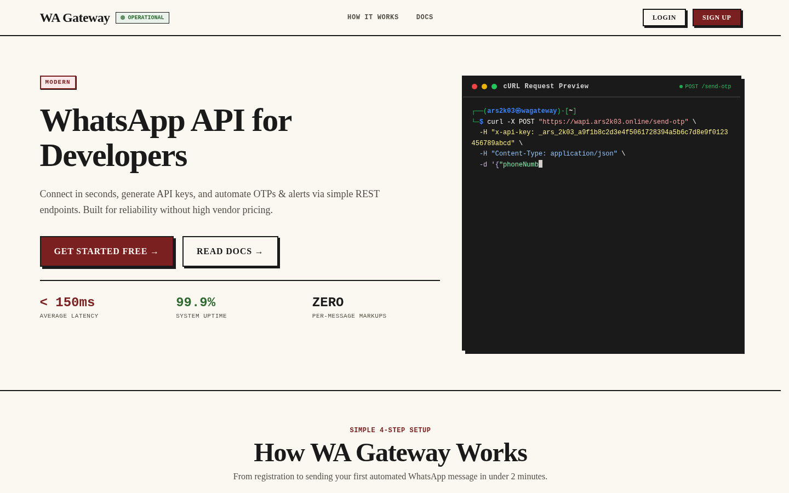
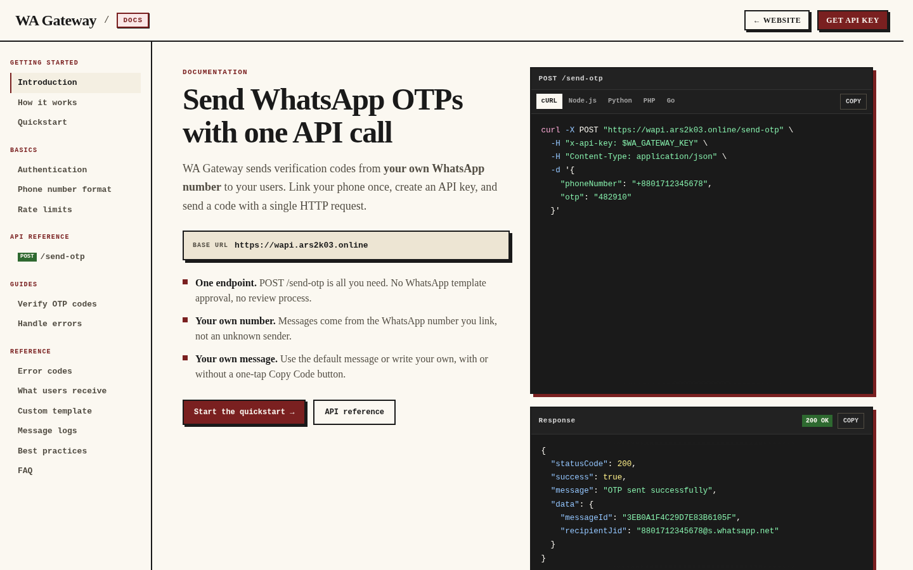
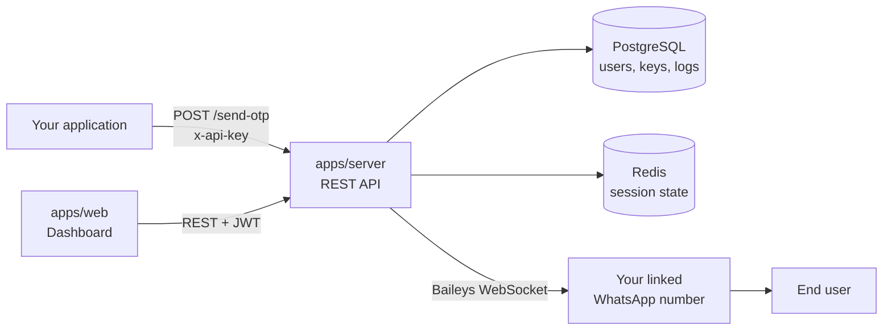

<div align="center">

<a href="https://wa.ars2k03.tech">
  
</a>

# WA Gateway

**Self-hosted WhatsApp OTP gateway. Link your number, create an API key and send codes with one HTTP request.**


[**Live site**](https://wa.ars2k03.tech) · [**API endpoint**](https://wapi.ars2k03.tech) · [**Docs**](https://wa.ars2k03.tech/docs) · [**API reference**](apps/server/docs/API.md) · [**Getting started**](#getting-started) · [**Contributing**](CONTRIBUTING.md)

</div>

> [!WARNING]
> WA Gateway is an independent project. It is not affiliated with, endorsed by or sponsored by WhatsApp or Meta. It connects through the unofficial [Baileys](https://github.com/WhiskeySockets/Baileys) library, not the WhatsApp Business Platform, and automated use may breach WhatsApp's terms and get a number restricted or banned. Use it at your own risk, and only message people who agreed to it.

---

## Screenshots

<table>
  <tr>
    <td width="50%"></td>
    <td width="50%"></td>
  </tr>
  <tr>
    <td align="center"><strong>Landing page</strong></td>
    <td align="center"><strong>Developer docs</strong></td>
  </tr>
</table>

## Features

**Messaging**

- Send OTPs from your own WhatsApp number through `POST /send-otp`
- Link a device by scanning a QR code, with live connection status
- Customize the message body and footer, and add an optional one-tap copy button
- Review sent messages in the message log

**Developer dashboard**

- Create and revoke API keys
- Send real test messages from the playground and inspect the response
- Track daily and monthly usage with a 30-day history chart
- Copy ready-made snippets for cURL, Node.js, Python, PHP and Go

**Platform**

- Multi-tenant accounts with email verification and JWT sessions
- WhatsApp session state stored in Redis
- Per-user limits of 100 OTPs a day and 3,000 a month
- Helmet headers and rate limiting of 30 requests a minute

## How It Works



## Apps

| App | Path | Stack | Dev port | Production URL |
|---|---|---|---|---|
| **REST API** | [`apps/server`](apps/server) | NestJS 12, Baileys, Prisma 7, PostgreSQL, Redis | `3002` | `https://wapi.ars2k03.tech` |
| **Website and dashboard** | [`apps/web`](apps/web) | Next.js 16, React 19, Tailwind CSS 4 | `3000` | `https://wa.ars2k03.tech` |

Each app has its own README with more detail.

## Repository Structure

```
whatsapp/
├── apps/
│   ├── server/           # NestJS REST API
│   │   ├── docs/         # API reference and Postman collection
│   │   ├── prisma/       # Schema and migrations
│   │   ├── src/          # One module per feature
│   │   └── test/         # Vitest tests
│   └── web/              # Next.js website and dashboard
├── assets/               # README screenshots
├── marketing/            # Promo material
├── package.json          # Root scripts
├── pnpm-workspace.yaml   # Workspace and allowed install scripts
└── turbo.json            # Task pipeline
```

## Getting Started

### Prerequisites

- Node.js 24 or newer (see [`.nvmrc`](.nvmrc))
- pnpm 12
- PostgreSQL and Redis
- A Google OAuth2 client with Gmail access, used to send verification emails
- A WhatsApp number you can link and are willing to risk

### Setup

1. Clone the repository and install dependencies:
   ```bash
   git clone https://github.com/ars2k03/whatsapp.git
   cd whatsapp
   pnpm install
   ```
2. Create the env files from their examples:
   ```bash
   cp apps/server/.env.example apps/server/.env
   cp apps/web/.env.example apps/web/.env.local
   ```
3. Fill in `apps/server/.env`:

   | Variable | Description |
   |---|---|
   | `PORT` | API port, `3002` by default |
   | `NODE_ENV` | Use `development` locally |
   | `ALLOWED_ORIGINS` | Comma-separated origins allowed by CORS |
   | `DATABASE_URL` | PostgreSQL connection string |
   | `REDIS_URL` | Redis connection string |
   | `JWT_SECRET` | Long random secret for signing sessions |
   | `JWT_EXPIRES_IN` | Session lifetime, for example `7d` |
   | `GMAIL_USER` | Address that sends verification emails |
   | `GMAIL_CLIENT_ID` | Google OAuth2 client ID |
   | `GMAIL_CLIENT_SECRET` | Google OAuth2 client secret |
   | `GMAIL_REFRESH_TOKEN` | Google OAuth2 refresh token |

   `apps/web/.env.local` needs only `NEXT_PUBLIC_API_URL`, which points to the API.

4. Generate the Prisma client and apply the migrations:
   ```bash
   pnpm --filter server prisma:generate
   pnpm --filter server prisma:migrate
   ```
5. Start both apps:
   ```bash
   pnpm dev
   ```

The dashboard opens at <http://localhost:3000> and the API runs at <http://localhost:3002>.

### Send Your First OTP

1. Register at <http://localhost:3000/register> and verify your email.
2. Open the dashboard and scan the QR code with WhatsApp.
3. Create an API key.
4. Send a code:
   ```bash
   curl -X POST http://localhost:3002/send-otp \
     -H "x-api-key: $WA_GATEWAY_KEY" \
     -H "Content-Type: application/json" \
     -d '{"phoneNumber": "+8801712345678", "otp": "482910"}'
   ```

Your application generates and verifies the code. WA Gateway delivers it.

## Scripts

Run from the repository root.

| Command | Description |
|---|---|
| `pnpm dev` | Start both apps |
| `pnpm build` | Build both apps (cached by Turborepo) |
| `pnpm lint` | Lint both apps |
| `pnpm test` | Run the tests |
| `pnpm --filter <server\|web> <script>` | Run any script of one app |
| `pnpm --filter server prisma:migrate` | Create and apply a database migration |

## Documentation

| Document | Description |
|---|---|
| [Developer docs](https://wa.ars2k03.tech/docs) | Integration guide with code samples |
| [`apps/server/docs/API.md`](apps/server/docs/API.md) | Full REST API reference |
| [`apps/server/README.md`](apps/server/README.md) | API architecture and setup |
| [`apps/web/README.md`](apps/web/README.md) | Website pages and dashboard features |
| [`apps/web/DESIGN.md`](apps/web/DESIGN.md) | Design system |
| [`CHANGELOG.md`](CHANGELOG.md) | Notable changes |

## Contributing

Contributions are welcome. Read [CONTRIBUTING.md](CONTRIBUTING.md) and [CODE_OF_CONDUCT.md](CODE_OF_CONDUCT.md) before opening an issue or pull request.

For help, see [SUPPORT.md](SUPPORT.md). To report a security issue or a leaked secret, follow [SECURITY.md](SECURITY.md), never a public issue.

## Author

Built by [A R S Arafat](https://github.com/ars2k03).

## License

[MIT](LICENSE) © 2026 A R S Arafat.
